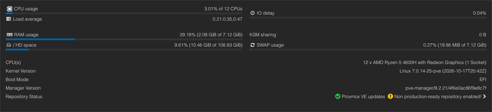
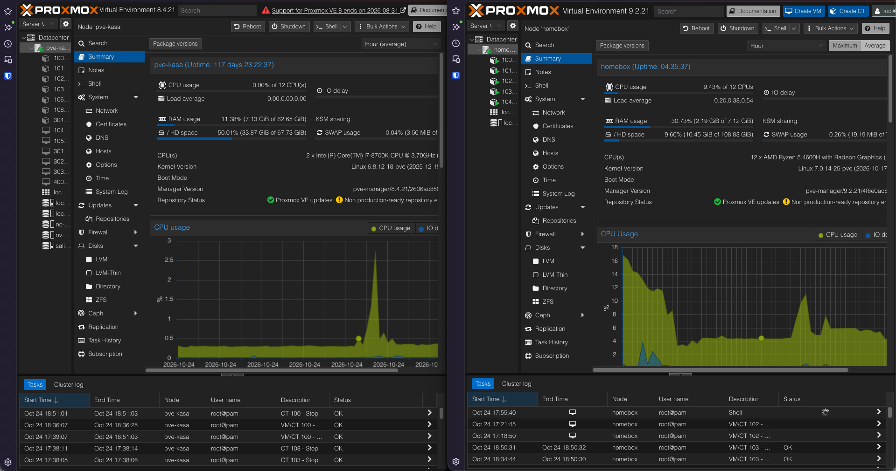

# Turning My Old Gaming Laptop into a Proxmox Home Server

## Hardware

I'm using an old HP Pavilion Gaming 15 that had been collecting dust, so I figured it was time to give it a second life as a home server.

| Component | Specification |
|---|---|
| Model | HP Pavilion Gaming 15 |
| CPU | AMD Ryzen 5 4600H with Radeon Graphics |
| CPU cores / threads | 6 cores / 12 threads |
| RAM | 8 GB DDR4 3200 MHz |
| Storage | 128 GB NVMe |
| Additional storage | 256 GB SATA SSD |
| Integrated GPU | AMD Radeon Graphics |
| Dedicated GPU | NVIDIA GeForce GTX 1650 |
| GPU memory | 4 GB GDDR6 |

One RAM slot isn't working, and I'm not great with electronics (something I want to work on). The keyboard also needs replacing, but I never got around to it. Despite these issues, the laptop is more than capable of handling the basic home services I want to run.



## Proxmox Install

I started by using BalenaEtcher to flash the Proxmox ISO onto a USB, changed the boot order, and booted from it. The GUI setup was pretty straightforward, so there wasn't much to it.

For reference, I followed this guide: [Proxmox installation guide](https://www.youtube.com/watch?v=qmSizZUbCOA).

I stopped after removing `local-lvm`, keeping the storage setup simple rather than spending time on something I didn't really need.

## Services & Storage

On my previous server, things got a bit messy. Why? Because I was piecing things together as I went along, and it was my first home server. This time, it's more purposeful. I want to run my basic home services while using as little valuable hardware as possible and repurposing this older laptop that's been collecting dust.

The storage layout is pretty simple — simple is better. I didn't want to be bothered with fancy partitioning, and my mindset is that if it breaks, it breaks. So, there are three partitions on the NVMe: BIOS boot, EFI, and LVM. The 256 GB SATA SSD hasn't been utilised yet, leaving some extra storage available for later.

For services, I kept the hardware requirements for my LXCs as low as possible, opting for Alpine Linux where possible. I set everything up using helper scripts, which made the process fairly straightforward. The services I'm running are:

- Pi-hole
- NPMplus
- Syncthing
- Vaultwarden
- Netbird

### Pi-hole

I started with Pi-hole, adding my blocklists and then running **Tools → Update Gravity** to sync them.

Once everything was set up, I pointed my network router to the Pi-hole container's IP for DNS. This meant devices on my network could use Pi-hole for DNS filtering without having to configure each one individually.

### NPMplus

Next up was NPMplus, which I use to manage access to my self-hosted services through my domain.

I set up the CNAME and A records for my domain and wildcard, then copied over the Cloudflare API token to generate the certificate.

I did run into a little issue here. The NPMplus LXC was still pointing towards the old Pi-hole, which was preventing it from reaching the Cloudflare API. A quick DHCP lease renewal sorted that out.

Afterwards, I added the domain names for the services I wanted to access and made sure the key services had static IP mappings to make life easier.

### Syncthing

Syncthing was pretty simple to migrate. I connected the new instance to my already-running Syncthing instance to transfer the files over, paired it with the device it syncs with, and then turned off the old Syncthing instance.

One difference was that I set the new server's folder to **receive only**. This way, changes made on the new server won't be propagated back to the other devices, helping prevent accidental changes or deletions from affecting everything else.

### Vaultwarden

For Vaultwarden, I exported my Bitwarden `.json` file and imported it into the new Vaultwarden instance.

After that, I logged back into the browser extension using the updated self-hosted address, and everything was good to go.

### Netbird

I use a Netbird-managed network for VPN, so setting it up was just a case of copying a link and logging in.

Afterwards, I set the Netbird LXC as the exit node, which allows me to access my home network when I'm away. This means I can reach my home services without having to expose everything directly to the internet.

## Extras

There were a couple of extra things I wanted to sort out to make the laptop work better as a server.

First, I automated the CPU governor change and made it persistent with a helper script, setting it to *powersave*. The idea was to keep power consumption down where possible, since the laptop will be running for extended periods.

I also went into `/etc/systemd/logind.conf` and uncommented these variables:

```ini
HandleLidSwitch=ignore
HandleLidSwitchExternalPower=ignore
HandleLidSwitchDocked=ignore
```

This lets me close the laptop lid and keep the server running, plus a lil bit less powerrrrr.

## Final Thoughts

Got it done in about 5–6 hours, with little bits of work in between, and turned off the old server afterwards.



The main thing I realised is how useful spare hardware can be. Instead of letting this laptop collect dust, I've managed to repurpose it into something useful while freeing up my previous server for better use elsewhere.

There were probably other little bits I missed, but I think I covered the majority. For now, it does what I need it to do, and that's the main thing. Keeping things simple was the goal, and I'm happy with how it turned out.
